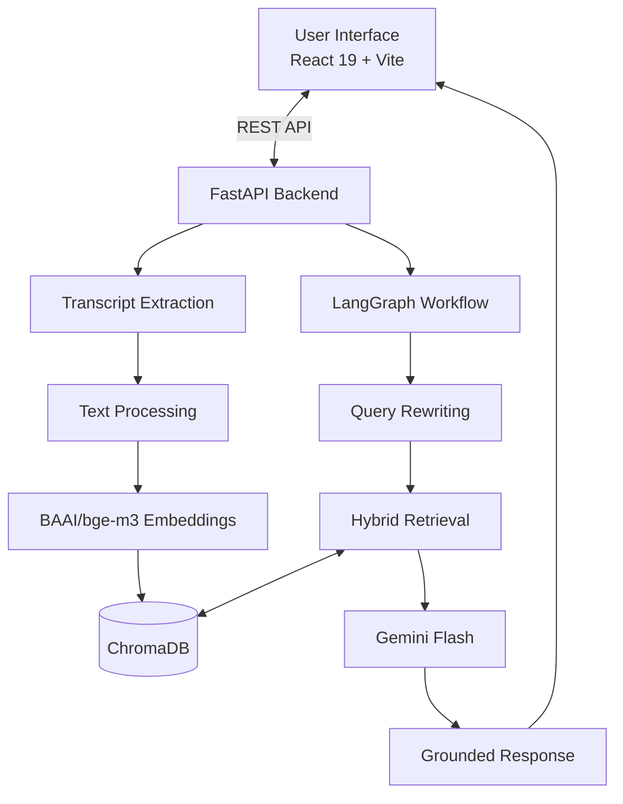
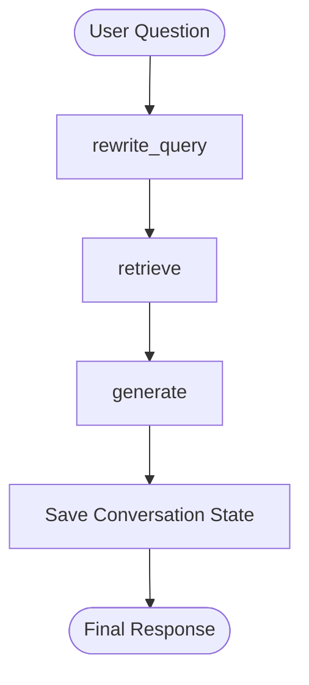

<div align="center">

# ENTHRA

### AI-Powered YouTube Conversational Intelligence

**Transform YouTube videos into interactive knowledge bases using Retrieval-Augmented Generation (RAG), LangGraph, and Google Gemini.**


*Watch less. Understand more.*

</div>

---

## 📌 Overview

Enthra is a multilingual, RAG-powered AI application that allows users to interact with YouTube videos through natural language conversations.

Instead of manually watching or navigating through lengthy videos, users can simply provide a YouTube URL and ask questions about its content.

The application automatically extracts the video transcript, processes it into meaningful chunks, generates semantic embeddings, and stores them in a persistent vector database.

When a question is asked, Enthra retrieves relevant transcript passages and passes them to Google Gemini to generate context-aware, timestamp-grounded responses.

The system uses LangGraph to manage multi-turn conversations, allowing users to ask follow-up questions without repeating the context.

## 🎯 Purpose

Long-form YouTube content often contains valuable information that can be difficult to locate.

Users frequently need to:

- Navigate through hours of video content.
- Manually search for specific explanations.
- Remember context from previous discussions.
- Find relevant information in Hindi, English, or Hinglish videos.
- Revisit specific moments to verify information.

The goal of Enthra is to simplify this process by turning videos into conversational knowledge sources.

## 🚀 Features

- Load YouTube videos using their URLs.
- Support standard, shortened, Shorts, embed, and live-video URL formats.
- Automatically extract manual and auto-generated transcripts.
- Multilingual transcript handling for Hindi and English.
- Language-aware text chunking.
- Hindi punctuation-aware text splitting.
- Generate semantic embeddings using `BAAI/bge-m3`.
- Store embeddings in persistent ChromaDB.
- Avoid redundant indexing of previously processed videos.
- Perform semantic similarity search.
- Multi-turn conversational RAG using LangGraph.
- Context-aware query rewriting.
- Hybrid retrieval combining semantic results and introductory context.
- Generate grounded responses using Google Gemini Flash.
- Include relevant video timestamps in AI responses.
- Interactive timestamp navigation to the original YouTube video.
- Markdown-formatted responses and code blocks.
- Dark and light interface themes.
- Configurable backend connection for local and remote access.

## 🧠 How It Works

Enthra follows a Retrieval-Augmented Generation architecture combined with a stateful conversational workflow.

The application consists of three major components:

1. **Frontend:** React-based interface for video submission, chat interaction, and timestamp navigation.
2. **Backend:** FastAPI REST API responsible for video ingestion, session management, and communication with the RAG pipeline.
3. **AI Pipeline:** LangGraph-based workflow responsible for query rewriting, semantic retrieval, and grounded response generation.

### System Architecture



## 🔄 RAG Pipeline

### 1️⃣ Video Ingestion

The user enters a YouTube URL through the React interface.

The application:

- Validates and extracts the YouTube video ID.
- Supports multiple YouTube URL formats.
- Checks whether the video has already been indexed.
- Retrieves the transcript using `youtube-transcript-api`.
- Fetches video metadata using the YouTube oEmbed API.

**Transcript Retrieval Priority:**

1. Manually created English or Hindi transcripts.
2. Auto-generated English or Hindi transcripts.
3. First available transcript as a fallback.

This fallback mechanism helps the application process videos with different caption configurations.

### 2️⃣ Transcript Processing & Chunking

The extracted transcript is divided into smaller overlapping chunks before generating embeddings.

**Current Configuration:**

| Parameter | Value |
|---|---:|
| Chunk Size | 1000 |
| Chunk Overlap | 200 |
| Primary Separators | Paragraphs, sentences, punctuation |
| Hindi Separator | `।` |

The project uses LangChain's `RecursiveCharacterTextSplitter`.

A custom Hindi punctuation separator (`।`) is included to preserve Indic sentence boundaries during text splitting.

### 3️⃣ Embedding Generation

Each transcript chunk is converted into a numerical vector representation.

**Embedding Model:**

`BAAI/bge-m3`

The model provides multilingual semantic representations, making it suitable for English and Hindi content.

The generated embeddings capture the semantic meaning of transcript passages rather than relying only on keyword matching.

### 4️⃣ Vector Database

The generated embeddings are stored in:

**ChromaDB**

Each stored chunk contains metadata such as:

- `video_id`
- `chunk_index`
- `language`

The video ID is used to filter retrieval results so that queries remain restricted to the currently selected video.

The vector database also uses persistent local storage to avoid repeating the embedding process for previously indexed videos.

### 5️⃣ Query Rewriting

Enthra uses LangGraph to maintain conversational context across multiple questions.

The workflow contains a `rewrite_query` node that converts context-dependent follow-up questions into standalone search queries.

For example, a follow-up question that contains pronouns or references to earlier messages is reformulated using the conversation history before semantic retrieval.

This improves retrieval accuracy by providing a more complete query to the embedding model.

### 6️⃣ Hybrid Retrieval

The `retrieve` node performs two retrieval operations:

**Semantic Retrieval**
- Searches ChromaDB using the rewritten query.
- Retrieves the top 6 semantically relevant chunks.

**Introductory Context Retrieval**
- Retrieves the first 3 chunks of the video.
- Preserves the introductory context of the video.

The retrieved chunks are then:

- Merged.
- Deduplicated using `chunk_index`.
- Sorted chronologically.
- Combined into a unified context.

This approach combines specific semantic information with the broader context of the video.

### 7️⃣ Answer Generation

The retrieved transcript context is passed to Google Gemini Flash.

The `generate` node uses a grounded system prompt that instructs the model to:

- Answer using the provided transcript excerpts.
- Avoid generating unsupported information.
- Include relevant timestamps in `[MM:SS]` format.
- Follow the language used by the user.
- Clearly indicate when information cannot be found in the available transcript.

The generated response is returned to the frontend for rendering.

## 🔁 LangGraph Workflow

The conversational pipeline consists of three main nodes:



| Node | Responsibility |
|---|---|
| `rewrite_query` | Reformulates follow-up questions using conversation history |
| `retrieve` | Performs hybrid retrieval using ChromaDB |
| `generate` | Generates grounded responses using Gemini |

### State Management

LangGraph maintains conversation state using a `ChatState` schema.

```python
class ChatState(TypedDict):
    messages: Annotated[list, add_messages]
    video_id: str
    query: str
    context: str
```

The `InMemorySaver` checkpointer maintains thread-isolated conversation state.

Each conversation receives a unique `thread_id`, allowing the application to distinguish between different chat sessions.

## ⏱️ Timestamp Navigation

One of Enthra's key features is interactive timestamp navigation.

The AI response includes timestamps referencing relevant portions of the original video.

The frontend parses these timestamps and converts them into clickable navigation links.

For example:

`[14:32]`

is converted into a YouTube URL that opens the video at 872 seconds.

This allows users to verify the generated response and revisit the exact portion of the video.

## 🛠️ Tech Stack

| Technology | Purpose |
|---|---|
| Python 3.10+ | Core backend programming language |
| React 19 | Frontend application |
| Vite | Frontend build tooling |
| Custom CSS | Responsive interface and theme management |
| FastAPI | Backend REST API |
| Uvicorn | ASGI server |
| LangGraph | Stateful agent orchestration |
| LangChain Core | LLM integration and message handling |
| Google Gemini Flash | Query rewriting and answer generation |
| Hugging Face | Embedding model integration |
| BAAI/bge-m3 | Multilingual embedding generation |
| ChromaDB | Persistent vector database |
| youtube-transcript-api | YouTube transcript extraction |
| YouTube oEmbed API | Video metadata retrieval |

## 📂 Project Structure

```text
Enthra/
│
├── api.py
│   └── FastAPI application and REST endpoints
│
├── transcript.py
│   └── YouTube URL parsing and transcript extraction
│
├── vector_store.py
│   └── Text chunking, embeddings, and ChromaDB operations
│
├── graph.py
│   └── LangGraph conversational RAG workflow
│
└── frontend/
    │
    ├── src/
    │   │
    │   ├── WelcomeScreen.jsx
    │   │   └── Video URL input and welcome interface
    │   │
    │   ├── LoadingScreen.jsx
    │   │   └── Video processing progress interface
    │   │
    │   ├── ChatScreen.jsx
    │   │   └── Main conversational interface
    │   │
    │   ├── StructuredResponse.jsx
    │   │   └── Markdown rendering and timestamp parsing
    │   │
    │   └── ApiSettingsModal.jsx
    │       └── Backend connection configuration
    │
    └── ...
```

## ⚙️ Complete Application Flow

```text
User enters YouTube URL
          │
          ▼
Extract Video ID
          │
          ▼
Check Existing Vector Index
          │
          ▼
Extract Video Transcript
          │
          ▼
Process and Clean Transcript
          │
          ▼
Split Transcript into Chunks
          │
          ▼
Generate BGE-M3 Embeddings
          │
          ▼
Store Embeddings in ChromaDB
          │
          ▼
Initialize Unique Chat Thread
          │
          ▼
User Asks a Question
          │
          ▼
LangGraph Workflow
          │
          ▼
Rewrite Query Using Chat History
          │
          ▼
Hybrid Retrieval
          │
          ▼
Retrieve Relevant Transcript Context
          │
          ▼
Generate Response Using Gemini
          │
          ▼
Include Relevant Timestamps
          │
          ▼
Render Interactive AI Response
```

## 💻 Web Application

The React frontend provides an interactive interface where users can:

- Submit YouTube video URLs.
- View video processing progress.
- Start conversations about video content.
- Ask follow-up questions.
- View structured Markdown responses.
- Navigate directly to relevant video timestamps.
- Configure backend connection settings.
- Switch between dark and light themes.

The interface is divided into three primary screens:

**1. Welcome Screen**
- YouTube URL input.
- Quick-start suggestions.
- Video submission.

**2. Loading Screen**
- Transcript extraction progress.
- Embedding generation progress.
- Chat initialization.

**3. Chat Screen**
- Multi-turn conversation interface.
- Structured AI responses.
- Clickable timestamps.
- Responsive sidebar and chat history.

## ⚠️ Challenges & Limitations

### 1️⃣ Transcript Availability

The application depends on transcripts provided by YouTube.

Some videos may not have accessible captions, and transcript availability can vary depending on the video and its caption configuration.

A future improvement could integrate an independent speech-to-text pipeline.

### 2️⃣ Multilingual Transcript Quality

Although BGE-M3 supports multilingual embeddings, the quality of retrieval still depends on the quality and structure of the extracted transcript.

Auto-generated captions may contain transcription errors, which can affect the final response.

### 3️⃣ In-Memory Conversation Storage

The current implementation uses LangGraph's `InMemorySaver` for conversation state.

Conversation state is not designed for permanent storage across backend restarts.

A persistent database integration is planned for future versions.

### 4️⃣ LLM Response Quality

The quality of generated responses depends on:

- Transcript accuracy.
- Query rewriting.
- Retrieved context relevance.
- Available context length.
- Language model capabilities.

Even with grounded prompts, responses may occasionally miss details or interpret ambiguous transcript passages incorrectly.

### 5️⃣ Large Video Processing

Long videos can require more time and computational resources for transcript processing and embedding generation.

The embedding pipeline also depends on local hardware capabilities.

### 6️⃣ Retrieval Limitations

The current retrieval strategy combines 6 semantic chunks with the first 3 introductory chunks.

Although this improves contextual coverage, some questions may require information spread across multiple sections of a video.

Future improvements could include reranking and more advanced retrieval strategies.

## 🚧 Future Improvements

- [ ] Whisper / Faster-Whisper integration for videos without accessible transcripts.
- [ ] Embedded YouTube player with in-chat timestamp navigation.
- [ ] Persistent conversation storage using SQLite or PostgreSQL.
- [ ] Retrieved transcript context inspector.
- [ ] Improved multilingual transcript processing.
- [ ] Advanced retrieval and reranking strategies.
- [ ] Better handling of very long videos.
- [ ] Improved conversation history management.
- [ ] Streaming AI responses.
- [ ] More detailed source references.

## 📊 Performance Characteristics

The following are observed performance figures from project testing.

| Metric | Observed Performance |
|---|---:|
| Transcript ingestion (30-minute video) | 1.5–3 seconds |
| Vector indexing | 2–4 seconds |
| Query rewriting | 400–600 ms |
| ChromaDB retrieval | Under 50 ms |
| Response generation | 1.0–1.8 seconds |

Actual performance may vary depending on hardware, network conditions, video length, and model response times.

### Testing Coverage

The system was tested with:

- Long-form podcasts exceeding two hours.
- Hindi and Hinglish educational lectures.
- Technical explanations and tutorials.
- Programming and code walkthroughs.
- Multi-turn conversational queries.
- Timestamp extraction and navigation.

## 🧠 Key Engineering Highlights

Some of the important technical decisions behind Enthra include:

**Context-Aware Query Rewriting**

Using conversation history to convert incomplete follow-up questions into standalone queries before retrieval.

**Hybrid Context Retrieval**

Combining semantic search results with introductory video chunks to preserve both specific and broader context.

**Multilingual-Aware Chunking**

Including Hindi punctuation separators to improve transcript segmentation for Indic languages.

**Persistent Vector Indexing**

Checking whether a video has already been indexed to avoid unnecessary embedding computation.

**Thread-Isolated Conversations**

Using LangGraph checkpointing to maintain separate conversation states for individual threads.

**Grounded Timestamp Responses**

Connecting AI-generated explanations to the original video through clickable timestamps.

---

<div align="center">

### ENTHRA

**Your videos. Your questions. One intelligent conversation.**

</div>
