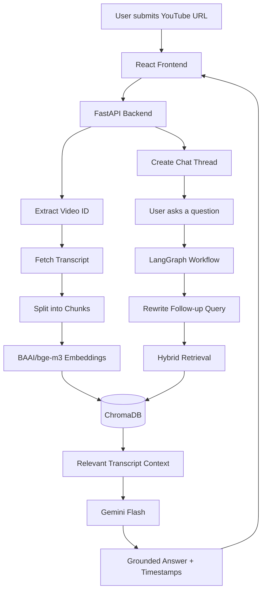
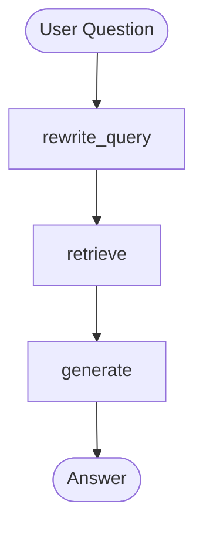

<div align="center">

# ENTHRA

### Turn YouTube videos into conversations.

**A multilingual, timestamp-aware YouTube intelligence assistant powered by RAG, LangGraph, and Google Gemini.**

[](https://www.python.org/)
[](https://react.dev/)
[](https://fastapi.tiangolo.com/)
[](https://www.langchain.com/langgraph)
[](https://www.trychroma.com/)
[](https://ai.google.dev/)

*Watch less. Understand more.*

</div>

---

## ✨ What is Enthra?

Enthra transforms a YouTube video into an interactive knowledge base that you can question in natural language.

Paste a YouTube URL, let Enthra process the video's transcript, and start a conversation about its content. Ask specific questions, explore ideas from earlier in the video, or ask follow-up questions without having to repeat the context.

Built around a **Retrieval-Augmented Generation (RAG)** pipeline and a **stateful LangGraph workflow**, Enthra retrieves relevant transcript passages and uses them to generate answers grounded in the video.

It is designed with multilingual content in mind, including **English, Hindi, and Hinglish**.

## 🎯 Why Enthra?

Long videos often contain useful information buried across hours of conversation. Finding one explanation can mean scrubbing through a timeline, scanning comments, or searching manually.

Enthra makes that process conversational:

- **Ask instead of scrub:** Find explanations and details by asking questions.
- **Keep the conversation going:** Ask follow-up questions that depend on earlier messages.
- **Get answers with timestamps:** Jump directly to the relevant moment in the original video.
- **Explore multilingual content:** Work with English, Hindi, and Hinglish transcripts.
- **Stay grounded in the source:** Responses are generated using retrieved transcript context rather than relying only on the model's general knowledge.

## 🚀 Features

| Feature | What it does |
|---|---|
| YouTube URL ingestion | Accepts standard, shortened, Shorts, embed, and live-video URL formats |
| Automatic transcript extraction | Tries manual captions, auto-generated captions, and an available-language fallback |
| Multilingual text processing | Handles Hindi punctuation and English/Hindi transcript content |
| Semantic search | Finds relevant transcript passages using BGE-M3 embeddings |
| Persistent vector index | Stores video chunks in ChromaDB and avoids re-indexing videos already indexed |
| Multi-turn conversations | Uses LangGraph state and query rewriting to understand follow-up questions |
| Hybrid retrieval | Combines the top 6 semantic matches with the first 3 introductory chunks |
| Timestamp-aware answers | Converts timestamps in responses into links that open the video at the relevant point |
| Markdown-friendly responses | Supports structured answers, emphasis, and code formatting |
| Flexible backend connection | Configure a local backend or a remotely exposed endpoint through the frontend |

## 🖥️ How It Works

At a high level, Enthra has three main parts:

1. **React frontend** for video submission, progress feedback, and the chat experience.
2. **FastAPI backend** for ingestion, session handling, and communication with the AI workflow.
3. **RAG pipeline** for transcript processing, vector retrieval, query rewriting, and answer generation.



### 1. Video Ingestion and Indexing

When a user submits a YouTube URL:

1. Enthra extracts the 11-character video ID from the URL.
2. It checks whether that video has already been indexed.
3. If needed, it retrieves the transcript using `youtube-transcript-api`.
4. Transcript selection follows this priority:
   - Manually created English or Hindi transcript
   - Auto-generated English or Hindi transcript
   - First available transcript as a fallback
5. The transcript is split into overlapping chunks.
6. `BAAI/bge-m3` converts the chunks into dense vector embeddings.
7. Chunks and metadata are stored in ChromaDB, associated with the video ID.

**Chunking Configuration**

| Setting | Value |
|---|---:|
| Chunk size | 1,000 characters |
| Chunk overlap | 200 characters |
| Hindi sentence separator | `।` |

The custom separator helps preserve Hindi sentence boundaries during splitting.

### 2. Multi-Turn RAG with LangGraph

Enthra uses a three-node LangGraph workflow:



| Node | Responsibility |
|---|---|
| `rewrite_query` | Uses conversation history to turn a follow-up into a standalone search query |
| `retrieve` | Fetches relevant transcript chunks and introductory context from ChromaDB |
| `generate` | Sends the retrieved context to Gemini and generates a source-grounded answer |

**Why Query Rewriting Matters**

Imagine this conversation:

- User: "Explain the Chandrayaan-3 mission."
- User: "How much did it cost?"

The second question is understandable in the conversation, but searching for the phrase *"How much did it cost?"* alone may not retrieve the right passage.

The query-rewriting node uses chat history to form a standalone query, such as *"What was the cost of the Chandrayaan-3 mission?"*, before retrieval.

**Hybrid Context Retrieval**

For each question, Enthra combines:

- The **top 6 semantic matches** returned by vector search.
- The **first 3 chunks** of the video, which provide introductory context.

The chunks are merged, deduplicated, sorted chronologically, and passed to the generation node.

**Grounded Response Generation**

The generation prompt instructs Gemini to:

- Answer using the supplied transcript excerpts.
- Include relevant timestamps in `[MM:SS]` format.
- Follow the language used by the user where possible.
- Say when the answer cannot be found in the available transcript context.

### 3. Timestamp Navigation

Enthra parses timestamps in the AI response and turns them into interactive links.

For example, a timestamp such as `[14:32]` becomes a YouTube link that opens the video at **872 seconds**.

This connects the answer back to its original source, so users can verify or explore the explanation in context.

## 🧰 Tech Stack

| Layer | Technology | Purpose |
|---|---|---|
| Frontend | React 19 | Interactive chat interface |
| Build tool | Vite | Frontend development and build tooling |
| Styling | Custom CSS | Responsive UI, themes, and visual design |
| Backend | FastAPI | REST API and request handling |
| ASGI server | Uvicorn | Runs the FastAPI application |
| Agent orchestration | LangGraph | Stateful, multi-step conversation workflow |
| LLM integration | LangChain Core | Message handling and model invocation |
| Language model | Google Gemini Flash | Query rewriting and answer generation |
| Embeddings | Hugging Face `BAAI/bge-m3` | Multilingual semantic embeddings |
| Vector database | ChromaDB | Persistent transcript-vector storage |
| Transcript extraction | `youtube-transcript-api` | Retrieves YouTube captions and transcripts |
| Video metadata | YouTube oEmbed API | Retrieves video titles |

## 🔌 Backend API

The FastAPI backend exposes the following endpoints:

| Method | Endpoint | Description |
|---|---|---|
| `POST` | `/chats` | Ingests a video and initializes a chat thread |
| `GET` | `/chats` | Lists available chat sessions |
| `GET` | `/chats/{thread_id}/messages` | Retrieves a thread's conversation history |
| `POST` | `/chats/{thread_id}/messages` | Submits a question and returns the AI response |

### Example: Create a Chat

**Request**

```json
{
  "url": "https://www.youtube.com/watch?v=kCc8FmEb1nY"
}
```

**Response**

```json
{
  "thread_id": "a93b4f12-0761-4fa3-9f82-a9bdf1184762",
  "video_id": "kCc8FmEb1nY",
  "title": "The spelled-out intro to neural networks and backpropagation",
  "url": "https://www.youtube.com/watch?v=kCc8FmEb1nY"
}
```

### Example: Ask a Question

**Request**

```json
{
  "question": "What is the role of the loss function?"
}
```

**Response Shape**

```json
{
  "answer": "The loss function measures how well the network is performing..."
}
```

The answer can include Markdown formatting and timestamp references that the frontend renders as interactive navigation links.

## 🧠 Notable Engineering Decisions

A few design choices make Enthra more than a basic transcript chatbot:

- **Query rewriting for conversational retrieval:** Follow-up questions are reformulated using chat history before semantic search.
- **Introductory context alongside semantic matches:** The first three chunks help preserve the video's broader context when a question focuses on a narrow detail.
- **Hindi-aware chunk splitting:** The Hindi danda (`।`) is included among the text separators.
- **Video-level indexing checks:** Previously indexed videos can reuse their stored vectors instead of repeating the embedding process.
- **Thread-isolated conversation state:** LangGraph's checkpointer keeps message state associated with a conversation thread.
- **Source-linked answers:** Clickable timestamps make it easier to verify an answer against the original video.

## 📊 Reported Performance

The following figures are observations recorded during project testing. Actual performance can vary with video length, hardware, network conditions, and model response times.

| Metric | Observed Time |
|---|---:|
| Transcript ingestion (average 30-minute video) | 1.5–3 seconds |
| Vector indexing | 2–4 seconds |
| Query rewriting | 400–600 ms |
| Local ChromaDB retrieval | Under 50 ms |
| Answer generation | 1.0–1.8 seconds |

**Test Coverage Included:**

- Long-form podcasts, including videos over two hours.
- Hindi and Hinglish lectures and explainers.
- Technical lectures and code walkthroughs.
- Multi-turn follow-up questions.
- Timestamp extraction and navigation.

## 🗺️ Roadmap

Planned improvements include:

- [ ] **Whisper transcription:** Support videos without accessible captions using Whisper or Faster-Whisper.
- [ ] **Embedded YouTube player:** Play the video inside the chat interface and jump to timestamps without opening a new tab.
- [ ] **Persistent chat database:** Move chat-session storage from in-memory structures to SQLite or PostgreSQL.
- [ ] **Retrieved-context inspector:** Let users inspect the transcript passages used to generate an answer.

## ⚙️ Getting Started

The implementation plan defines the architecture and API, but does not include the final repository-specific dependency files or exact run commands. Add the verified commands for your project before publishing this section.

**Prerequisites**

- Python 3.10 or later
- Node.js and npm
- A Google Gemini API key
- Access to the YouTube transcript service

### Configuration

Set up the Gemini API key in the backend environment. Keep secret keys out of source control. Do not commit `.env` files or API credentials to GitHub.

### Run the Application

Add the actual installation and startup commands for your repository here once your `requirements.txt` / `pyproject.toml` and frontend `package.json` are finalized.

## 📁 Project Structure

The implementation plan identifies these core backend modules and frontend components. Update this tree to match the exact files in your repository.

```text
Enthra/
├── api.py
├── transcript.py
├── vector_store.py
├── graph.py
└── frontend/
    ├── src/
    │   ├── WelcomeScreen.jsx
    │   ├── LoadingScreen.jsx
    │   ├── ChatScreen.jsx
    │   ├── StructuredResponse.jsx
    │   └── ApiSettingsModal.jsx
    └── ...
```

## 🔐 Notes

- Transcript availability depends on the video and the captions made available by YouTube.
- The quality of answers depends on transcript quality and the relevance of retrieved passages.
- Chat state is described as in-memory in the current implementation plan. It should not be treated as permanent, cross-restart conversation storage.
- Keep API keys and other credentials private.

## 🤝 Contributing

Suggestions, bug reports, and improvements are welcome.

1. Fork the repository.
2. Create a branch for your change.
3. Make and test your changes.
4. Open a pull request with a clear description.

## 📄 License

No license has been specified yet. Add a `LICENSE` file and update this section before presenting the project as open source.

---

<div align="center">

**ENTHRA**

*Your videos. Your questions. A conversation that understands the context.*

</div>
